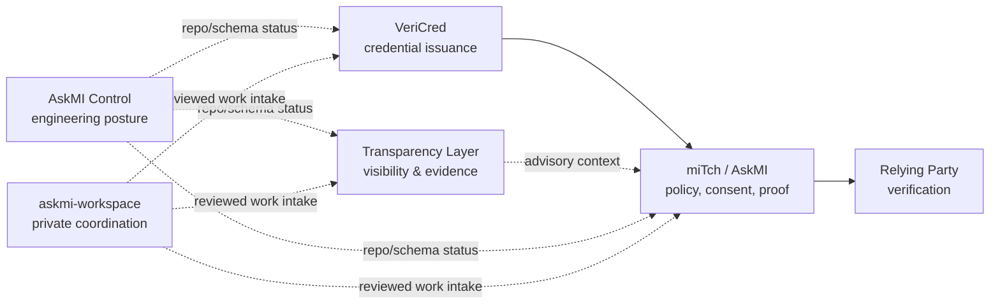

# Ecosystem role and boundaries

**Status:** Architecture direction for v0.4  
**Baseline date:** 2026-10-27  
**Programme tracker:** [Issue #20](https://github.com/Late-bloomer420/miTch-Transparency-Layer/issues/20)

> The Transparency Layer is the AskMI ecosystem's local **Visibility & Evidence Companion**. It observes and explains browser-visible surfaces. It is not an identity authority, verifier, policy authority, compliance oracle, fraud engine, or authorization component.

## Product role

The Transparency Layer helps a person or reviewer answer three separate questions:

1. **Observed facts:** What did this collector actually observe in the browser during this scan?
2. **Potential access:** What information could the contacted page or servers receive from normal browser interaction?
3. **Unknowns:** What cannot be established from a browser extension, especially remote retention, profiling, resale, and internal processing?

Its useful output is an understandable view and an explicitly exported, versioned receipt. The extension processes locally and does not automatically centralize its observations.

## Ecosystem map

## Authority matrix

| Component | Owns | Does not own |
|---|---|---|
| VeriCred | Credential issuance and issuer-side OID4VCI behavior | Wallet consent, presentation authorization, browser-surface analysis |
| miTch / AskMI | Policy evaluation, request mediation, consent, holder/presentation behavior | Issuer authority, remote-site behavior claims |
| Transparency Layer | Browser-visible observations, evidence states, local explanations, advisory proof suggestions | Credential validity, verifier trust, authorization, legal necessity, fraud or compliance decisions |
| AskMI Control | Repository/engineering posture over a declared source surface | End-user browsing receipts, identity decisions |
| askmi-workspace | Private context, coordination and reviewed work-item routing | Public implementation truth or production runtime |
| Relying Party | Its own purpose, legal basis, request and retention duties | Automatic entitlement to raw attributes |

## Non-negotiable boundaries

### Observation is not proof

A field name, cookie, API call or network request is evidence of a browser-visible event or surface. It is not proof of:

- the site's legal basis;
- server-side storage or retention;
- data resale or profiling;
- malicious intent;
- identity, credential or verifier validity; or
- actual use of an available capability unless the collector observed the call.

### Potential is not observed

User agent, screen, language, timezone and IP visibility must stay in the potential-access layer unless an observation mechanism establishes a more specific event. The UI and exported receipt must preserve this distinction.

### Unknown does not mean safe

An unavailable or limited scan cannot be rendered as a clean page. Remote behavior that cannot be observed stays explicitly unknown.

### Surface Score is not a verdict

The score is an informational summary of configured surface inputs. It must never be used or described as:

- a trust score;
- a legal-compliance score;
- a fraud/suspicion score;
- proof that a low-scoring site is safe; or
- an input to credential disclosure.

### Local-only by default

The extension must not automatically send receipts, observations or proof suggestions to miTch, VeriCred, AskMI Control, askmi-workspace, a relying party or any backend. Export is a deliberate user action.

### No form values

Form inspection is limited to structural metadata such as name, id, type, autocomplete, placeholder and aria-label. Typed values, credentials and submitted payloads are outside scope.

## Integration contracts

### 1. Surface Receipt

The versioned receipt contract is defined in [TRANSPARENCY_RECEIPT_V1.md](TRANSPARENCY_RECEIPT_V1.md).

It carries:

- collection provenance and coverage;
- observed facts;
- potential access;
- unknowns;
- separated domain/request counts;
- rule and collector versions;
- limitations; and
- no typed form values or credential contents.

### 2. Proof Suggestion

The v0.3 Proof Bridge is advisory:

- high-confidence DOB-like form metadata may suggest canonical `age_over_18`;
- ambiguous, health and financial fields produce no automatic claim mapping;
- the suggestion never starts or authorizes OID4VP;
- the wallet independently validates request, relying party, policy, binding, consent and presentation state;
- the current localhost deep-link remains explicit opt-in and experimental.

A Proof Suggestion is not a proof and is not an authorization request.

### 3. miTch pre-login visibility

[miTch issue #220](https://github.com/Late-bloomer420/miTch/issues/220) may reuse the three-layer presentation pattern for an on-device introduction.

It must not:

- depend on the installed extension;
- import browsing history;
- send the panel output to an audit log or backend;
- turn device/browser data into a decision signal; or
- imply that the limited pre-login panel equals an extension scan.

### 4. AskMI Control

AskMI Control may monitor:

- repository revision;
- manifest and schema versions;
- open security/evidence gaps;
- test/CI status; and
- contract compatibility.

It must not ingest end-user receipts by default.

### 5. VeriCred

VeriCred has no runtime dependency on the Transparency Layer. Developer tooling may scan a VeriCred test UI, but the resulting receipt is test evidence rather than issuer or credential truth.

### 6. askmi-workspace

The workspace may route reviewed work items to this repository. Private interview, customer and operational context remains private; only implementation-safe, non-personal work items enter the public repository.

## Versioning

- Breaking receipt changes require a new schema version.
- Proof Suggestion and Receipt versions evolve independently.
- Canonical AskMI claim names must be version-pinned and compatibility-tested.
- Copying a vocabulary into this repository does not make this repository its authority.
- Unknown versions fail validation explicitly; they are not silently coerced.

## Current verified limitations

At the 2026-10-27 baseline:

- the manifest and source are v0.3.0;
- the README still points to a v0.1 release zip;
- the post-merge #8 review found incomplete Three-Layer Report serialization and a request/domain count-label defect;
- `registrableApproximation()` is not Public-Suffix-List aware;
- host permissions cover all HTTP/HTTPS pages;
- the MAIN-world observer needs stronger behavior-preservation evidence;
- Proof Bridge tests cover the canonical DOB mapping and localhost guard, but not the full observation/receipt surface;
- v0.3 is an experimental local tool, not certified, audited or established as production-ready.

These limitations are tracked by [issues #14–#19](https://github.com/Late-bloomer420/miTch-Transparency-Layer/issues).

## Decision rule

No ecosystem integration may weaken the local-only boundary or turn browser observations into identity, trust, disclosure, fraud or legal decisions. When usefulness and authority conflict, the Transparency Layer remains informative and advisory.
