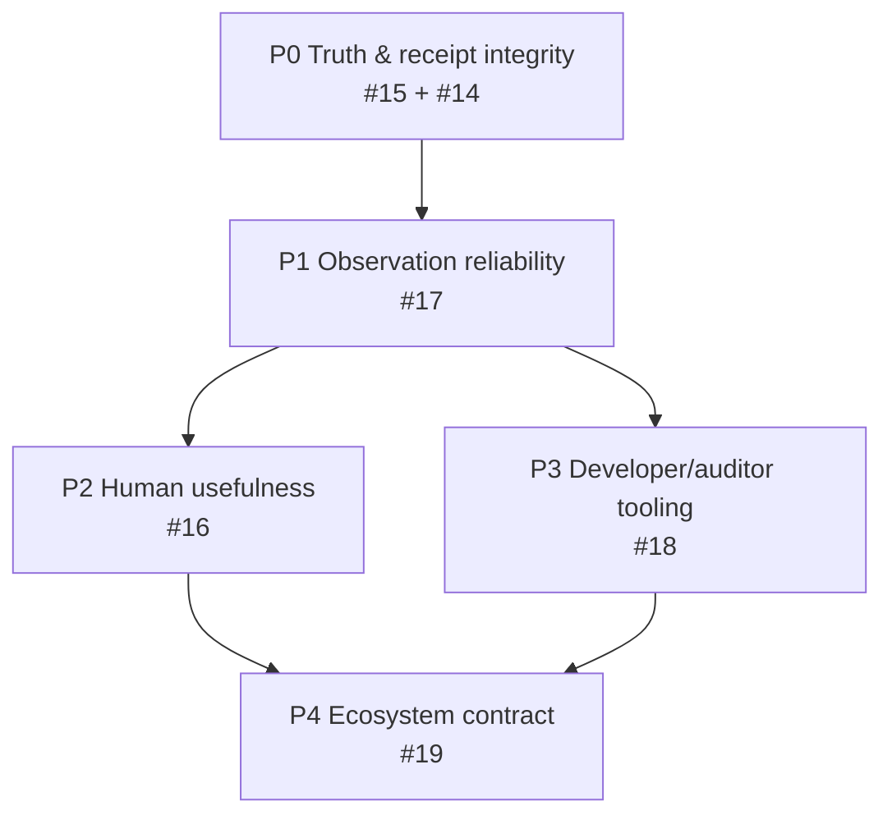

# Product roadmap v0.4 — trustworthy Visibility & Evidence Companion

**Status:** Active planning baseline  
**Baseline date:** 2026-10-27  
**Live programme:** [Issue #20](https://github.com/Late-bloomer420/miTch-Transparency-Layer/issues/20)  
**Current implementation:** v0.3.0, experimental/local-only

> Roadmap items are planned work. They are not completed features, readiness evidence or release claims.

## Product outcome

The v0.4 programme makes the Transparency Layer useful to three audiences without changing its authority boundary:

1. **People:** understand what a page exposes and what choices exist.
2. **Developers/site owners:** detect privacy-surface regressions.
3. **Reviewers/auditors:** receive bounded, versioned technical evidence.

The extension remains outside identity, credential, relying-party trust, authorization and disclosure decisions.

## Work sequence

## P0 — truth, receipt and release integrity

### [#15 Complete and correct Surface Receipts](https://github.com/Late-bloomer420/miTch-Transparency-Layer/issues/15)

Deliver:

- one shared report model for UI/JSON/Markdown;
- complete observed/potential/unknown export;
- explicit unavailable evidence;
- correct separation of requests, unique domains and known tracker domains; and
- regression tests for the #8 post-merge findings.

### [#14 Scan provenance, score semantics, CI and v0.3 release integrity](https://github.com/Late-bloomer420/miTch-Transparency-Layer/issues/14)

Deliver:

- scan modes/status and limitations;
- collector, rules and source provenance;
- transparent Surface Score components;
- deterministic CI;
- revision-bound release package/checklist; and
- honest handling of the stale v0.1 zip.

### P0 exit

- A failed/limited scan cannot appear clean.
- JSON and Markdown preserve the full Three-Layer Report.
- The current distributable matches its manifest/source/test evidence.
- No compliance, safety or audit-readiness claim is introduced.

## P1 — observation reliability and least privilege

### [#17 Observation reliability, site boundaries and permissions](https://github.com/Late-bloomer420/miTch-Transparency-Layer/issues/17)

Deliver:

- host-behavior preservation tests for MAIN-world wrappers;
- bounded dynamic DOM rescans;
- Public-Suffix-List/eTLD+1-aware site classification;
- request/domain count accuracy;
- on-demand versus continuous collection design; and
- explicit permission explanations.

### P1 exit

- Instrumentation does not change tested host-page outcomes.
- Dynamic pages are observed without unbounded work.
- Domain classification passes representative fixtures.
- The chosen permission model has a documented necessity review.

## P2 — usefulness for people

### [#16 Human-centred Transparency Layer](https://github.com/Late-bloomer420/miTch-Transparency-Layer/issues/16)

Deliver:

- plain-language evidence explanations;
- action choices without alarmist conclusions;
- observed versus possible-over-collection distinction;
- before/after comparisons;
- local opt-in history with deletion;
- German/English UI; and
- accessibility evidence.

### P2 exit

- A normal user can distinguish observed, potential, unknown and unavailable.
- Heuristics are not presented as legal violations.
- Core flow works with keyboard/screen reader and without colour-only meaning.

## P3 — developer and reviewer tooling

### [#18 Receipt validator, CLI and CI diff](https://github.com/Late-bloomer420/miTch-Transparency-Layer/issues/18)

Deliver:

- `askmi.transparency.surface-receipt.v1` JSON Schema;
- validator and deterministic fixtures;
- local controlled-browser scanner;
- privacy-surface diff;
- optional sanitized GitHub Action artifacts; and
- documented coverage and error limits.

### P3 exit

- Same fixture/rule version yields the same normalized receipt.
- CI artifacts contain no secrets, cookies, form values or stable device identifiers.
- Diffs show added, removed, changed and unavailable evidence.

## P4 — AskMI ecosystem integration

### [#19 Ecosystem integration contract](https://github.com/Late-bloomer420/miTch-Transparency-Layer/issues/19)

Deliver:

- adopted [ecosystem role and boundaries](ECOSYSTEM_ROLE_AND_BOUNDARIES.md);
- adopted [Receipt v1 contract](TRANSPARENCY_RECEIPT_V1.md);
- versioned Proof Suggestion compatibility;
- askmi-workspace routing entry;
- proposed canonical miTch ecosystem reference update;
- miTch #220 reference-only integration; and
- AskMI Control schema/repository monitoring without receipt ingestion.

### P4 exit

- Every cross-repository relationship states direction, data boundary and authority.
- Browser observations cannot authorize or deny disclosure.
- No receipt is automatically centralized.
- Contract compatibility is tested.

## Now / next / later

### Now

1. #15 — repair the exported evidence model.
2. #14 — make scan state, score and release artifact truthful.
3. Run existing Proof Bridge tests and add receipt/score fixtures.

### Next

4. #17 — harden observation and permission behavior.
5. #16 — build the user-facing explanation/comparison layer.

### Later

6. #18 — CLI/CI/auditor tooling after Receipt v1 stabilizes.
7. #19 — finish cross-repository adoption after the contracts are testable.

## Evidence policy

Close work only with a linked commit, deterministic test result, review or revision-bound artifact. Screenshots and plans may explain behavior but do not prove implementation correctness. A feature present in v0.3 does not automatically satisfy a v0.4 gate.
